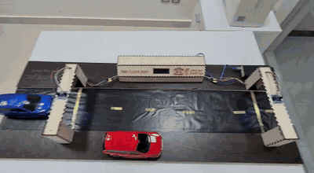
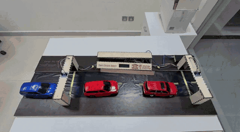
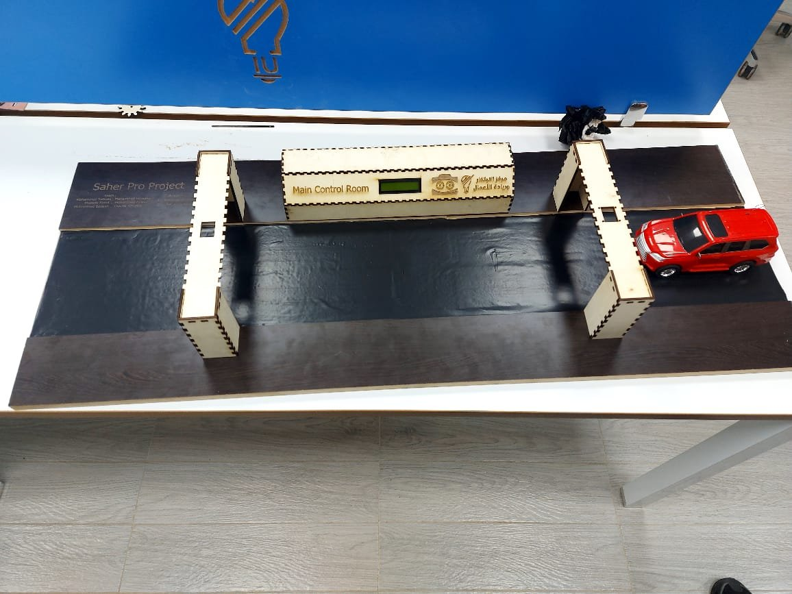
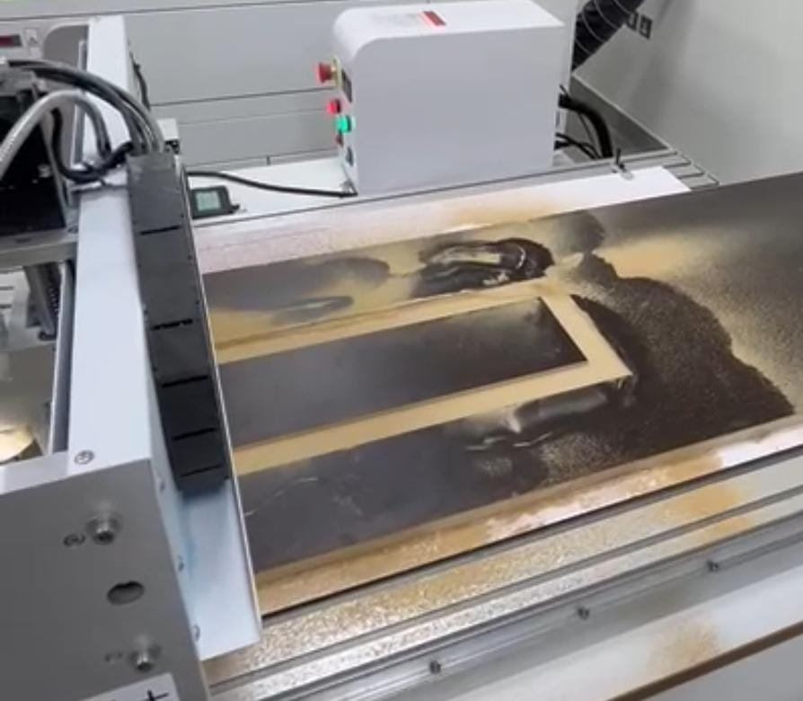
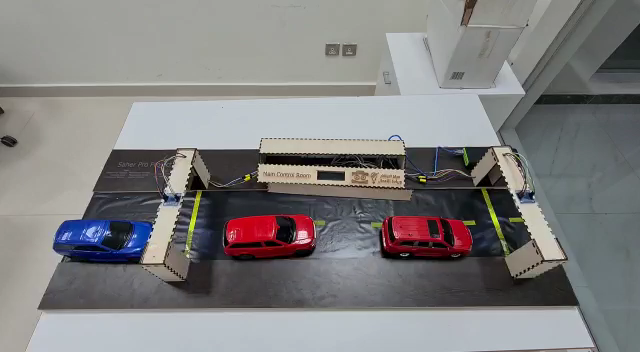
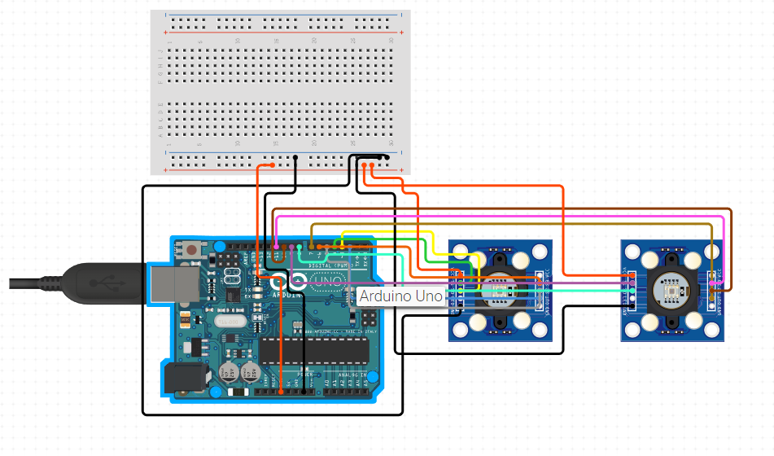
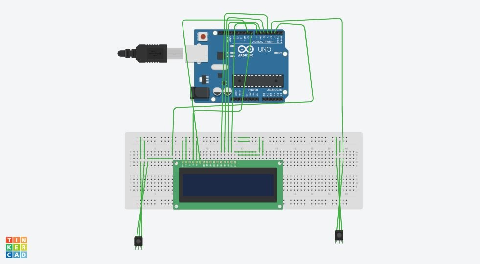
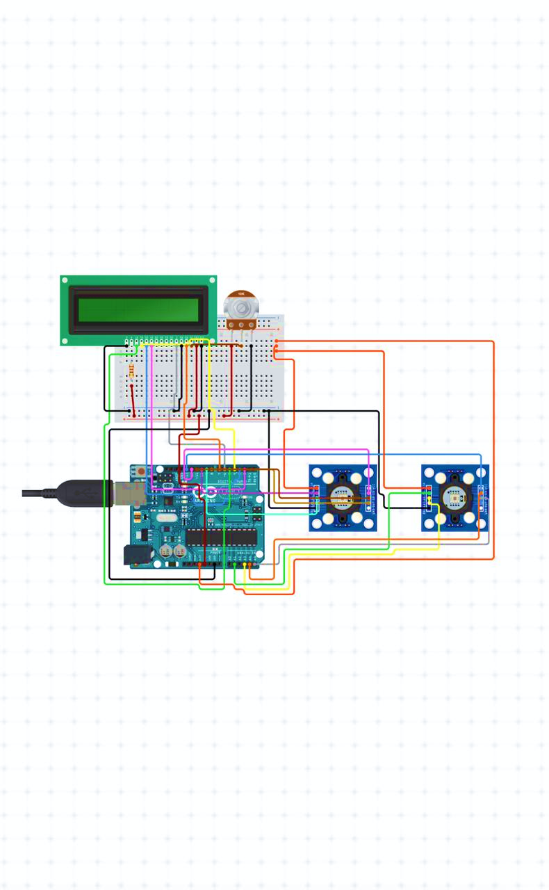

# Saher Pro: Average-Speed Enforcement Prototype

> Innovation and design project · team project · Arduino · colour sensors · CNC-cut model

**Problem:** Saudi Arabia's *Saher* speed cameras measure speed at a single point. Drivers who know where a camera is simply brake just before it and speed up again.

**Solution:** *Saher Pro* measures a vehicle's **average speed between two checkpoints**, so slowing down only at the camera no longer works. This repository holds a working scale model.

## Demo
| Car passes both checkpoints, then the LCD shows the verdict | Full operation |
|---|---|
|  |  |

More videos in [`media/`](media/): [testing](media/testing.mp4) · [operation](media/operation.mp4) · [colour-sensor test](media/sensor.mp4) · [road](media/road.mp4) · [installation](media/installation_preparing.mp4)

| The model | Road cut on a CNC machine |
|---|---|
|  |  |

## How it works
1. Two **TCS3200 colour sensors** are mounted on gantries at the start and end checkpoints of a model road.
2. When a car passes checkpoint 1, the Arduino records the time. When it passes checkpoint 2, the Arduino computes **speed = distance ÷ time**.
3. A **16×2 LCD** in the "main control room" shows the speed and whether the car is **overspeeding**.

## Hardware
| Component | Role |
|---|---|
| Arduino Uno | Timing and speed calculation |
| 2 × TCS3200 colour sensor | Checkpoint detection |
| 16×2 LCD | Result display |
| Breadboard + jumper wires | Wiring |
| CNC-cut wooden road and gantries | Scale model |

| Sensor wiring | LCD wiring | Full circuit |
|---|---|---|
|  |  |  |

## Future work
Licence-plate cameras for identifying vehicles, and combining instantaneous (Saher) and average (Saher Pro) speed checks.
